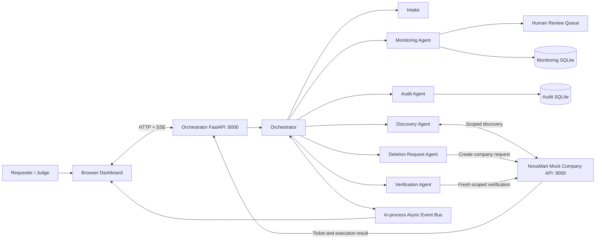

# Architecture

## Trust boundary

The orchestrator coordinates work. The Deletion Request Agent prepares and submits requests only through an explicitly authorized company interface. A separate fictional NovaMart service represents the company's own system and mutates generated demo records only after an explicit simulated company approval.

## Components

- **FastAPI orchestrator application (port 8000):** dashboard, intake endpoints, agent status, workflow APIs, audit/monitoring, and Server-Sent Events.
- **Orchestrator:** coordinates six specialist agents and routes workflow progression.
- **Six specialist agents:** Intake, Discovery, Deletion Request, Verification, Audit, and Monitoring.
- **Shared Pydantic contracts:** typed messages and request/response payloads.
- **In-process asynchronous event bus:** distributes workflow events to subscribers and the live dashboard.
- **NovaMart mock company API (port 9000):** separate FastAPI service for synthetic discovery, company tickets, approval, and simulated execution.
- **SQLite stores:** audit, monitoring, and human-review records.
- **Browser dashboard:** intake, scenario controls, agent graph, event terminal, monitoring, and review queue.

## System context

## Request lifecycle

1. Intake validates the demo request and preserves the selected category IDs.
2. Discovery asks the NovaMart simulator to find matching synthetic records for that customer and category scope.
3. Deletion Request submits an authorized request to the company simulator and receives a company ticket. It does not directly erase company data.
4. A simulated company operator explicitly approves the ticket. The company-side simulator mutates only generated records listed in that approved ticket.
5. Verification independently re-scans the approved category scope.
6. If leftovers remain, a bounded retry may create a new company ticket for the leftover item IDs. Each retry needs a fresh company approval.
7. Audit records privacy-minimized workflow events. Monitoring tracks deadlines, retries, and escalation conditions.
8. Human-review tickets surface cases requiring a person. Marking a ticket reviewed does not itself delete data or approve a company ticket.

## Scenario modes

- **A / normal:** company approval removes the requested synthetic records; verification should pass.
- **B / replica_lag:** first execution preserves an EmailVendor copy; a retry can clear it.
- **C / persistent_failure:** executions preserve records so the retry cap and escalation can be demonstrated.

Scenario launchers intentionally bypass OTP for deterministic judge demos. The normal intake path demonstrates the local Dev Inbox OTP flow.

## Privacy and operational limitations

- Do not place raw identifiers, OTP values, or document contents in audit events.
- NovaMart records and company tickets are synthetic and in-memory.
- The local Dev Inbox is not proof of real contact ownership; no real SMS or email is sent.
- Legal rules and deadlines are illustrative configuration and require qualified review.
- The local simulated approval endpoint is not production authorization. A real deployment needs authenticated company operators and a company-owned integration.
- The hash chain detects ordinary tampering but is not immutable against a privileged administrator who can rewrite the full database. Production requires protected keys and independently anchored checkpoints.
