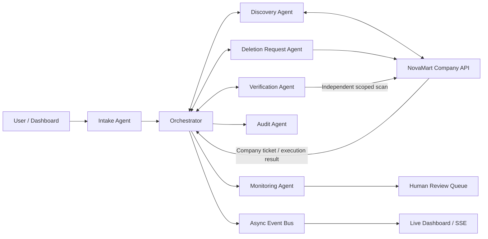

# Judge Viva Guide

## 30-second project explanation

DPDP Erasure Orchestrator is an offline, privacy-conscious multi-agent prototype that coordinates a personal-data erasure request across a fictional company's systems. Six specialist agents handle intake, discovery, company deletion requests, independent verification, audit, and monitoring. The key safety boundary is that our agents do not directly delete arbitrary company data: the company remains responsible for approval and execution through its authorized systems.

## Problem and proposed solution

A person's data may be spread across multiple company systems, replicas, caches, and vendors. A request therefore needs coordination, traceability, follow-up, and evidence that the requested scope was checked. This prototype demonstrates that workflow using generated records and a fictional company API.

## The six agents

| Agent | Responsibility | Output |
|---|---|---|
| Intake | Validates request fields, demo OTP session, selected categories, and illustrative policy rules | Accepted scoped request |
| Discovery | Searches NovaMart's configured synthetic systems for the requested customer and categories | Matching item IDs and system references |
| Deletion Request | Submits an authorized request to NovaMart; does not itself erase company data | Company ticket and company response |
| Verification | Independently re-scans the approved category scope after company execution | Verified result or leftover IDs |
| Audit | Stores privacy-minimized events in a SQLite SHA-256 hash chain | Auditable event history and integrity result |
| Monitoring | Tracks deadlines, retries, ticket states, and escalations | Monitoring snapshot and human-review triggers |

The orchestrator coordinates these six specialists. It is not counted as a seventh specialist agent.

## Request lifecycle

1. The user selects NovaMart, identifies their demo customer record, chooses categories, and completes the demo OTP step.
2. Intake validates the request and preserves the selected categories as the scope.
3. Discovery asks the separate NovaMart simulator to locate matching synthetic records.
4. Deletion Request submits an erasure request to the company simulator and receives a company ticket.
5. A simulated company operator explicitly approves the ticket. Only the company-side simulator mutates generated records.
6. Verification independently scans the full approved category scope.
7. If leftovers remain, the orchestrator can create a bounded retry request for those leftover IDs. Every retry requires another simulated company approval.
8. Audit records workflow events. Monitoring tracks retry limits and deadline breaches; unresolved cases can enter Human Review.

## Architecture at a glance

## What makes it agentic?

- **Specialized responsibilities:** each agent owns a defined part of the workflow.
- **Tool use:** agents call typed internal services and the separate company API.
- **Stateful coordination:** request and ticket state determines the next action.
- **Feedback loop:** verification findings can cause a new bounded request.
- **Guardrails:** retries are capped, selected categories remain the scope, and company approval is explicit.
- **Human escalation:** unresolved or out-of-policy cases are surfaced rather than silently declared complete.

This is a deterministic, tool-using multi-agent prototype. Do not claim that it uses a trained autonomous LLM for every decision; the core workflow is implemented with explicit rules and API calls.

## Demo scenarios

- **A — Happy path:** company approval removes the synthetic requested records; verification should report `VERIFIED`.
- **B — Replica lag:** the first approval deliberately leaves the EmailVendor copy; verification finds it; a retry and second approval clear it.
- **C — Persistent failure:** simulated company approvals preserve records; bounded retries are exhausted and a human-review ticket is opened.

The scenario launcher bypasses OTP intentionally for a predictable judge demonstration. Use the normal intake flow to demonstrate the demo OTP inbox.

## Limitations and honest disclosures

- NovaMart is fictional; all records are generated demo data.
- The NovaMart store and company tickets are in-memory and reset when the process restarts.
- Demo OTP appears in the local Dev Inbox; no real email or SMS is sent and this is not proof of real-world identity or contact ownership.
- The configured legal policy and deadline are illustrative. They are not legal advice or a definitive interpretation of DPDP obligations.
- The prototype does not connect to real company systems, production vendors, or immutable backup infrastructure.
- The simulated company approval endpoint is for local demonstration only. A production deployment needs authenticated company staff, authorization checks, access controls, durable queues, and company-specific integrations.
- A hash chain can reveal ordinary record alteration, but an administrator able to rewrite the entire database may also recompute the chain. Production audit integrity needs separately protected keys and externally anchored checkpoints.

## Likely viva questions

### 1. Why use multiple agents instead of one chatbot?
The workflow has distinct operational responsibilities and state transitions. Separate agents make the responsibilities, inputs, outputs, retries, and audit events easier to inspect and test.

### 2. Does your AI delete data directly from a company's server?
No. The Deletion Request Agent submits a scoped request to an authorized company interface. The company approves and executes it. The NovaMart simulator demonstrates that boundary using synthetic records only.

### 3. How do you avoid deleting data outside the user's request?
The selected category IDs are carried through the request, discovery, company ticket, retry, and verification. The company API validates categories and execution is limited to the customer, categories, and item IDs in the approved ticket.

### 4. What happens if a replica or vendor copy remains?
Verification independently scans the approved category scope. If it finds leftovers, the workflow can submit a new bounded company request containing only those leftover IDs. The company must approve that retry too.

### 5. What prevents infinite retries?
Monitoring enforces a maximum retry count of three. Once exhausted, another retry is refused and a human-review ticket is opened.

### 6. Why is verification independent?
The verification step performs a fresh discovery call after company execution instead of trusting only the company's success response. It compares the current scoped results with the requested scope.

### 7. What is stored in the audit log?
The audit database stores request references, a keyed subject hash, agent/action/outcome, counts, categories, timestamps, and hash-chain fields. It avoids storing raw email addresses, phone numbers, and OTP values.

### 8. Is the audit log impossible to tamper with?
No. The hash chain detects ordinary changes to stored rows. It is not absolute protection against an administrator rewriting the entire database and recomputing hashes. Production needs protected keys and independent anchoring.

### 9. What happens to backups or data that must be retained?
The intended workflow supports retention and human-review outcomes. This current demo does not implement a real immutable backup system; do not claim it does.

### 10. Is the OTP production-ready?
No. It is an offline demo mechanism surfaced in a local Dev Inbox. Production requires a delivery provider, secure secret handling, rate limiting, durable session storage, and stronger identity verification.

### 11. What is the role of the orchestrator?
It coordinates the six specialist agents, routes results, advances workflow state, and decides whether to verify, retry, or escalate based on explicit rules.

### 12. What would you build next for production?
Integrate an authenticated company API, persistent workflow queue, durable state store, real identity verification, access control, secrets management, observability, independently anchored audit logs, and reviewed company-specific retention/legal policies.

## Suggested closing statement

Our prototype demonstrates a controlled and auditable coordination workflow, not a universal delete button. The central design decision is that the company remains the authority that executes deletion, while the agents help scope, coordinate, verify, and monitor the request.
